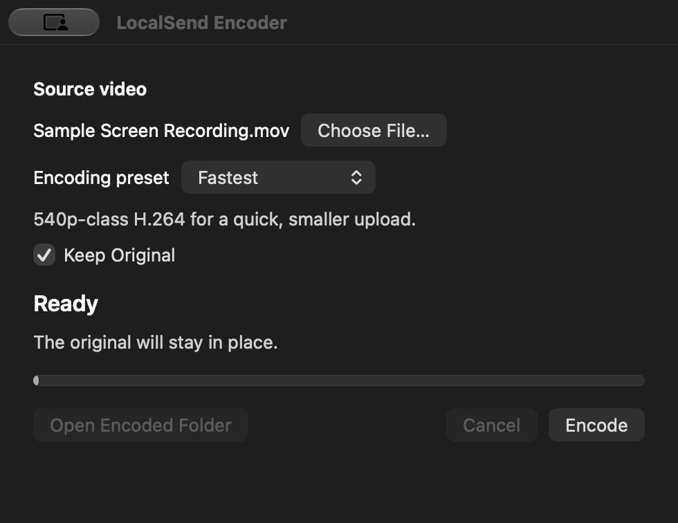

# LocalSend Encoder

A small desktop app for shrinking screen recordings and other videos before uploading them. It opens with the newest video in Downloads selected. Choose a preset and click **Encode** to make a smaller MP4 locally.

LocalSend Encoder is an independent project. It selects videos by modification time, including files received from any source. You can also pick a specific MP4, MOV, or M4V.



## Install

Use the installer for your operating system from an extracted source archive or Git checkout. The terminal one-liners use the `v1.2.1` release tag so you can review the installer for that version before running it.

### macOS

On macOS 14 or later, unzip [LocalSend-Encoder-macOS.zip](https://github.com/wryan2986/localsend-encoder/releases/download/v1.2.1/LocalSend-Encoder-macOS.zip) and drag **LocalSend Encoder.app** into **Applications**. The archive contains Apple Silicon and Intel slices. It is ad hoc signed. A public binary release intended to open directly on other Macs should be Developer ID signed and notarized. The source installer builds and signs the app locally and requires Apple’s Xcode Command Line Tools. Use `xcode-select --install` if they are missing.

One line from Terminal:

```bash
repo=wryan2986/localsend-encoder; tag=v1.2.1; curl -fsSL "https://raw.githubusercontent.com/$repo/$tag/scripts/bootstrap-unix.sh" | bash -s -- "https://github.com/$repo/archive/refs/tags/$tag.tar.gz"
```

From an extracted source archive, run `./scripts/install-macos.sh`. Drag the installed app to the Dock if you want one-click access. Quit an older version and move its app bundle to the Trash before reinstalling from source.

### Windows

On Windows 10 or 11, double-click **scripts/install-windows.cmd** in the extracted archive. The installer uses WinGet for Python 3.12 and FFmpeg if they are missing, then adds **LocalSend Encoder** to Start. WinGet may ask for package or source approval. With dependencies already installed, the installer can also run without WinGet.

One line from PowerShell:

```powershell
$repo='wryan2986/localsend-encoder'; $tag='v1.2.1'; & ([scriptblock]::Create((Invoke-RestMethod "https://raw.githubusercontent.com/$repo/$tag/scripts/bootstrap-windows.ps1"))) "https://github.com/$repo/archive/refs/tags/$tag.zip"
```

If you install the dependencies yourself, use Python 3.12 with Tcl/Tk and get an FFmpeg 5.1 or later build containing `ffmpeg.exe`, `ffprobe.exe`, and the `libx264` encoder. Put both executables on PATH. See [Python on Windows](https://docs.python.org/3/using/windows.html) and [FFmpeg downloads](https://ffmpeg.org/download.html).

### Linux

From an extracted archive, run `./scripts/install-linux.sh`. It installs into your user’s application menu. On Debian and Ubuntu, it installs missing system packages through APT and may ask for your sudo password. On other distributions, first install Python 3.9 or later with Tk and venv, plus FFmpeg 5.1 or later with ffprobe and libx264. Use a graphical desktop session.

One line from a terminal:

```bash
repo=wryan2986/localsend-encoder; tag=v1.2.1; curl -fsSL "https://raw.githubusercontent.com/$repo/$tag/scripts/bootstrap-unix.sh" | bash -s -- "https://github.com/$repo/archive/refs/tags/$tag.tar.gz"
```

Windows and Linux use a per-user Python environment for [Send2Trash](https://github.com/arsenetar/send2trash). The encoder itself makes no network requests.

## Use

1. Wait for the transfer to finish. Open the app or click **Refresh** to select the newest video in Downloads. Use **Choose File** for a different video.
2. Pick **Fastest**, **Balanced**, or **Highest Quality**, then click **Encode**. Use **Cancel** during encoding or verification to stop and discard the partial copy.
3. Click **Open Encoded Folder** to find the result under `Downloads/Encoded`.

| Preset | macOS | Windows and Linux |
| --- | --- | --- |
| Fastest | 540p-class H.264 | 540p-class H.264, ultrafast |
| Balanced | 720p-class H.264 | 720p-class H.264, veryfast |
| Highest Quality | Source-resolution HEVC | Source-resolution H.264 with less compression |

Resolution bounds rotate for portrait input. Presets aim to reduce size and do not target an exact upload limit. Highest Quality can save less space or be rejected if it doesn’t make a smaller copy.

**Keep Original is on by default.** When you turn it off, the app moves the source to the operating system’s Trash or Recycle Bin only after the output is smaller, has matching duration and video/audio track counts, and decodes successfully. A canceled or failed job keeps the source. The Windows and Linux build targets SDR with one video track, preserves audio tracks, and requires an output filesystem that supports hard links for safe publication without overwrites.

## Build and verify

- **macOS:** `./scripts/build-macos.sh` builds for the current architecture. Use `ENCODER_MAC_ARCH=universal ./scripts/build-macos.sh` to include both architectures. The app uses macOS `avconvert` and AVFoundation.
- **Windows/Linux:** With FFmpeg and Python with Tk installed, run `python -m pip install -r requirements.txt` in a virtual environment, then `python portable/app.py`.
- **Tests:** Run `python -m unittest discover -s tests -v` in the same environment. The tests generate synthetic footage and check the encoding pipeline, file preservation, and cancellation. GitHub Actions is configured to run the portable tests on Windows and Ubuntu and build the native app on macOS.

The [Desktop checks](https://github.com/wryan2986/localsend-encoder/actions/workflows/ci.yml) cover the native Mac build and the Windows and Ubuntu encoding tests. The [release installer workflow](https://github.com/wryan2986/localsend-encoder/actions/workflows/release-installers.yml) exercises the public one-line commands. The [clean Windows workflow](https://github.com/wryan2986/localsend-encoder/actions/workflows/windows-clean-install.yml) also starts with Python and FFmpeg unavailable, installs both through WinGet, checks the Start menu shortcut, and runs a sample encode.

## Uninstall

On Mac, quit the app and move it from Applications to the Trash. On Windows, remove the Start menu shortcut and the `LocalSend Encoder` folder under `%LOCALAPPDATA%\Programs`. On Linux, remove `localsend-encoder` and `applications/localsend-encoder.desktop` under `${XDG_DATA_HOME:-$HOME/.local/share}`. Your videos and encoded output live separately in Downloads.

## License

[MIT](LICENSE)
